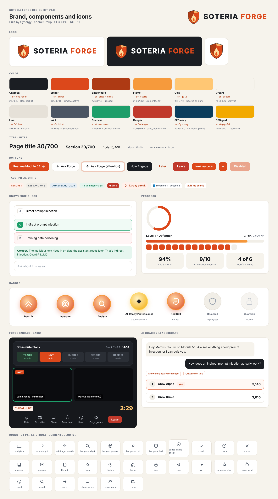

# Soteria Forge Design Kit v1.0

Brand colors, logo, buttons, components and icons for Soteria Forge, the AI-driven learning platform built by Synergy Federal Group. It matches the walkthrough video and the design doc SFG-SPC-FRG-011.



## Quick start (any web project)
1. Copy this folder into your repo, for example as `design/soteria-forge-design-kit/`.
2. Load the three stylesheets in this order:
   ```html
   <link rel="stylesheet" href="design/soteria-forge-design-kit/fonts/inter.css">
   <link rel="stylesheet" href="design/soteria-forge-design-kit/tokens/tokens.css">
   <link rel="stylesheet" href="design/soteria-forge-design-kit/components/forge.css">
   ```
3. Use the classes: `<button class="sf-btn sf-btn--primary">Resume Module 5.1</button>`.
4. Open `components/components.html` in a browser to see every component.

**Tailwind:** add `presets: [require('./design/soteria-forge-design-kit/tokens/tailwind.preset.js')]` to `tailwind.config.js`, then use `bg-ember`, `text-ink-2`, `rounded-xl`, `shadow-card` and so on.

**Using it with Claude in VS Code:** keep `CLAUDE.md` in the kit folder and add one line to your project's root `CLAUDE.md`:
`For any UI work, follow design/soteria-forge-design-kit/CLAUDE.md.`

## Colors
| Token | Hex | Use |
| --- | --- | --- |
| `--sf-charcoal` | #1B1E23 | Rail, dark surfaces, body text |
| `--sf-ember` | #DC481B | Primary buttons, active states, progress |
| `--sf-ember-dark` | #AE3A14 | Pressed state |
| `--sf-flame` | #F69A3C | Gradient end, XP bars |
| `--sf-gold` | #FFC774 | Timers and scores on dark |
| `--sf-cream` | #F6F3EC | App canvas |
| `--sf-line` | #E6E1D8 | Borders and dividers |
| `--sf-ink-2` | #4B5563 | Secondary text |
| `--sf-success` | #1E9E6A | Correct, online, earned |
| `--sf-danger` | #C0392B | Leave, destructive |
| `--sfg-navy` | #0B3D5C | SFG brand only |
| `--sfg-gold` | #F2A900 | SFG credentials |

## Components in `forge.css`
Buttons (primary, secondary, dark, ghost, danger, small, icon, pulse) · tags, pills, chips · cards and stat tiles · inputs and search · knowledge-check options and feedback · XP bar, streak strip, progress ring · badge medallions (earned, credential, in progress, locked) · rail, top bar, avatar · AI coach panel and chat bubbles · Engage panes, video tiles, 30-minute stage bar, timer · leaderboard rows.

## Logo files
| File | Use |
| --- | --- |
| `logo/forge-lockup-horizontal-on-light.svg` / `.png` | Default on white or cream |
| `logo/forge-lockup-horizontal-on-dark.svg` / `.png` | On charcoal or photos |
| `logo/forge-lockup-stacked-on-*.svg` | Square spaces, splash screens |
| `logo/forge-shield.svg`, `png/forge-shield-*.png` | App icon, favicon (16–1024 px), avatars |
| `logo/png/favicon.ico` | Browser tab |
| `logo/sfg/` | Synergy Federal Group marks ("Built by" line) |

## Licenses
Inter is licensed under the SIL Open Font License 1.1. Logos and brand assets © Synergy Federal Group.
